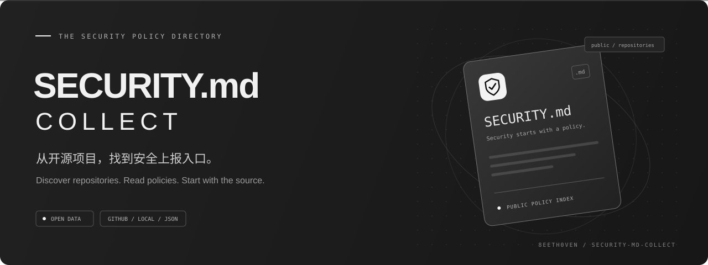

[简体中文](README.md) · [English](README.en.md)

# Open-source security policy index

Look up a repository or vendor to find its published `SECURITY.md`, reporting channel and disclosure policy. The Android directory links public program records to app identifiers and official sources.

- Browse or download the policy index. [Online dashboard](https://8eeth0ven.github.io/security-md-collect/) · [CSV](索引/总表.csv) · [JSON](索引/dashboard.json)
- Check Android program scope and review dates. [Android directory](赏金APK/README.md)

To browse the bundled snapshot locally, run `python3 脚本/serve.py` from the repository root with Python 3.10 or later. Open the address printed in the terminal. Viewing the snapshot needs no GitHub token.

Snapshots may lag upstream. Check the program's current official policy for reporting terms, scope and reward eligibility. [Coverage audit](docs/coverage.md) · [Snapshot statistics](索引/统计.json) · [Maintenance guide](CONTRIBUTING.md)
