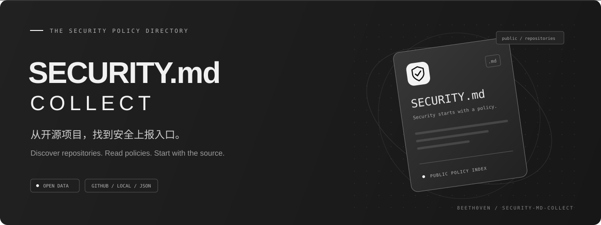
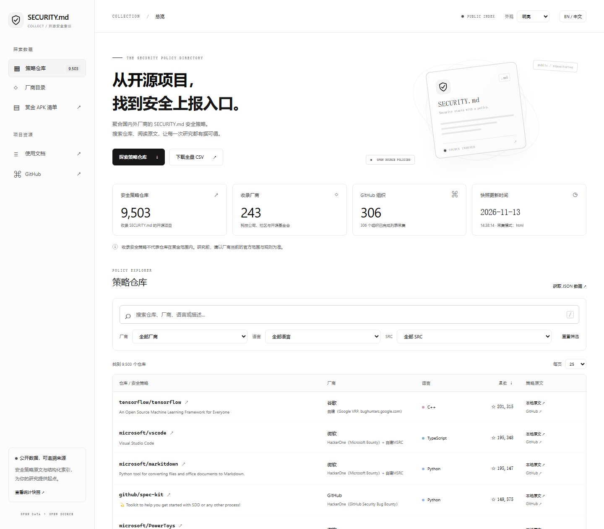
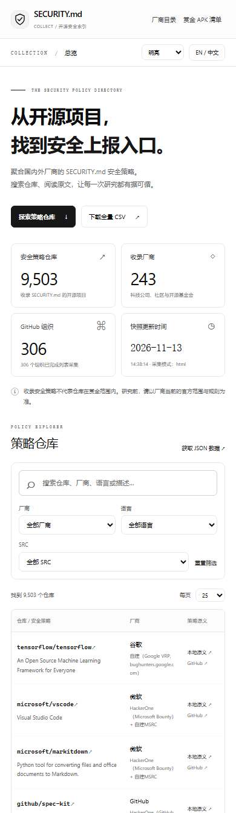
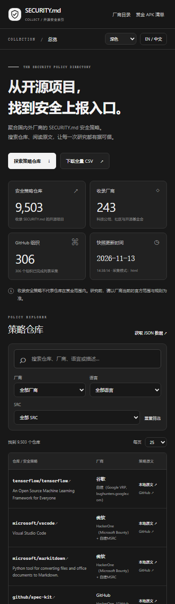

<div align="center">



**国内外厂商开源仓库的安全策略索引。搜索项目，阅读原文，找到披露入口。**

[在线探索](https://8eeth0ven.github.io/security-md-collect/) · [下载 CSV](索引/总表.csv) · [JSON 数据](索引/dashboard.json) · [赏金 APK](https://8eeth0ven.github.io/security-md-collect/赏金APK/赏金APK看板.html) · [参与维护](CONTRIBUTING.md)


</div>

## 先看效果

默认使用纯白的明亮主题。右上角「外观」可切换 **明亮 / 深色 / 跟随系统**，自动记住选择。



<details>
<summary>查看深色主题截图</summary>


</details>

<details>
<summary>查看手机端截图</summary>
<br>


</details>

截图是 **2026-11-13 的数据快照**，其中有 9,503 条有效仓库记录、243 个厂商和 306 个 GitHub 组织；最新数量与时间以[在线统计](https://8eeth0ven.github.io/security-md-collect/索引/统计.json)为准。历史上误计入的 908 条网络错误记录已移入[待重试清单](索引/retry-candidates.json)，保留元数据以便追溯；它们不再计入安全策略仓库数。后续记录若暂缺本地原文，则仅显示 GitHub 来源入口。

## 能做什么

- **找策略**：搜索仓库名、厂商、语言、许可证或描述；按厂商、语言、SRC 来源交叉筛选。
- **看全部结果**：按仓库、厂商、语言、星数排序；每页 25 / 50 / 100 条，支持首末页，覆盖全部匹配记录。
- **读原文**：打开已保存的 `SECURITY.md`，或直接访问 GitHub 默认分支的上游策略。
- **复用数据**：下载 CSV，用每厂商的 JSON 或聚合快照继续分析。
- **分享检索**：筛选、排序和页码保存在 URL；中英文切换保留当前筛选，按 `/` 快速聚焦搜索框。
- **切换外观**：默认明亮，支持深色与跟随系统；刷新、跨标签页和语言切换时保持选择，浏览器禁止存储时仍可在当前页切换。

这是**公开安全策略索引**。厂商映射覆盖公开披露计划、SRC、科技公司与开源基金会；拥有 `SECURITY.md` 不代表仓库当前有赏金或属于授权测试范围。以厂商当前官方规则为准。

## 数据入口

| 想做什么 | 从这里开始 |
| --- | --- |
| 在线搜索全部仓库 | [策略看板](https://8eeth0ven.github.io/security-md-collect/) |
| 用表格工具浏览 | [索引/总表.csv](索引/总表.csv)（UTF-8 BOM） |
| 程序读取整库 | [索引/dashboard.json](索引/dashboard.json)（含字段说明：[数据结构](docs/architecture.md#数据字段)） |
| 查看统计、快照时间和失败组织 | [索引/统计.json](索引/统计.json) |
| 某厂商的仓库和原文 | [厂商/](厂商/) 下的 `清单.md`、`repos.json`、`{owner}__{repo}/SECURITY.md` |
| 浏览 Android 目标清单 | [赏金 APK 说明](赏金APK/README.md)与[独立看板](https://8eeth0ven.github.io/security-md-collect/赏金APK/赏金APK看板.html) |
| 让其他 Agent 分析公开数据 | [分析提示词](prompt-给其他Agent.md) |

APK 分类保留独立数据与看板，平台数量、包名、下载入口和更新时间以该目录的快照为准。

## 本地打开：不采集也能用

需要 **Python 3.10+**。先克隆项目，再启动只依赖 Python 标准库的本地服务：

```bash
git clone https://github.com/8eeth0ven/security-md-collect.git
cd security-md-collect
python 脚本/serve.py
```

打开 <http://127.0.0.1:8899>。服务默认只监听本机，`/status` 返回统计 JSON。若需向局域网共享，显式运行 `python 脚本/serve.py --host 0.0.0.0 --port 8899`。请通过 HTTP 打开页面，浏览器直接双击 HTML 可能无法加载 JSON。

只想调整页面或从公开快照重建，不需要 token，也不会请求 GitHub：

```bash
python 脚本/build_dashboard.py
```

已有旧版本快照可先运行 `python 脚本/repair_snapshots.py` 预览误收录数，再用 `--apply` 隔离历史 `sec_path=error` 记录并重建索引；原始元数据会保留到待重试清单。

## 增量采集

安装依赖后执行：

```bash
python -m pip install -r requirements.txt
python 脚本/collect.py --budget 1500
```

默认数据根目录是当前仓库，配置位于 `脚本/config.json`。有 token 时尝试 GitHub code search；无 token 时使用公开仓库列表和 raw 文件探测。token 通过 `GH_TOKEN` / `GITHUB_TOKEN` 或本地的 `资产/.gh_token` 提供，勿提交到 Git。GitHub 搜索存在限额，大组织可能截断；这不是全网所有安全策略的完整清单。

<details>
<summary>配置独立数据目录、代理和 token</summary>

PowerShell：

```powershell
# 可选；独立目录应已有 资产/ 与 脚本/config.json 等配置
$env:SECMD_BASE = "D:\data\security-md-collect"
$env:SECMD_PROXY = "http://127.0.0.1:7897"
# 在本机设置 GH_TOKEN 或 GITHUB_TOKEN 后运行；不要把 token 写进代码
python 脚本/collect.py --budget 1500
```

Bash：

```bash
export SECMD_BASE="/path/to/security-md-collect"
export SECMD_PROXY="http://127.0.0.1:7897"
python 脚本/collect.py --budget 1500
```

`SECMD_BASE` 供采集器、本地服务和生成器共用。代理默认留空，`SECMD_PROXY` 优先于配置文件；也支持 Requests 的标准代理环境变量。TLS 默认校验证书，自定义证书环境可配置 `REQUESTS_CA_BUNDLE`。

</details>

| 配置 / 参数 | 用途 |
| --- | --- |
| `--budget 秒数` | 本轮采集预算 |
| `--force` | 忽略组织列表缓存，强制重扫 |
| `threads_probe` / `threads_download` / `threads_listing` | 探测、下载、列表采集并发数 |
| `org_resweep_hours` | 组织列表重新采集间隔 |
| `SECMD_BASE` | 指定数据目录，默认仓库根目录 |
| `SECMD_PROXY` / `proxy` | 可选 HTTP 代理 |

采集器带断点状态与进程锁，避免任务重叠。需要每 30 分钟运行时，可接入自己的调度器；本仓库不包含定时任务。

已有独立采集目录需要同步到发布仓库时，使用只同步公开数据的脚本。它保留发布仓库的页面和代码版本，并在目标仓库重新生成看板：

```bash
python 脚本/sync_github.py --base /path/to/data --repo /path/to/checkout --dry-run
# 检查来源、目录与目标分支后，显式提交和推送
python 脚本/sync_github.py --base /path/to/data --repo /path/to/checkout --push
```

目标工作区须干净，默认分支 `main`。`--push` 会先 fast-forward 拉取，再提交数据并正常推送；不带该参数时仅同步到本地供检查。不要继续使用会覆盖页面、脚本和配置文件的旧同步器。

## 项目结构与开发

```text
├── index.html                 生成后的 Pages 入口
├── web/                       独立 CSS、JavaScript、SVG 标识
├── docs/                      架构说明、封面与真实截图
├── 厂商/{厂商名}/              仓库元数据与 SECURITY.md 原文
├── 索引/                      CSV、统计、聚合快照
├── 资产/                      厂商 → GitHub 组织映射
├── 赏金APK/                   独立的 Android 目标数据
├── 脚本/
│   ├── collect.py             增量采集与输出
│   ├── build_dashboard.py     从公开快照重建页面
│   ├── repair_snapshots.py    隔离历史网络失败误收录，保留待重试元数据
│   ├── dashboard.html         页面模板（改这里，再重建）
│   ├── serve.py               本地公开数据服务
│   ├── sync_github.py         独立采集目录 → 发布仓库，仅同步公开数据
│   └── config.json            可移植配置
└── tests/                     生成器、服务与浏览器回归检查
```

新增厂商请添加 `资产/厂商映射-*.json`，下一轮采集合并生效。不要直接修改自动生成的 `vendors.json` 或根页面。详见[贡献指南](CONTRIBUTING.md)和[架构与发布约定](docs/architecture.md)。

```bash
python -m pip install -r requirements-dev.txt
python -m unittest discover -s tests -v
python -m playwright install chromium
python tests/browser_checks.py
```

## 来源与使用

仓库元数据和策略来自 GitHub 公开信息，原文版权归上游所有者；快照可能滞后于上游。运行状态、组织缓存、日志和 token 文件不纳入版本管理。本项目不替代厂商政策，也不保证漏洞报告受理或赏金资格。

感谢公开安全策略的维护者。欢迎通过 [Issue](https://github.com/8eeth0ven/security-md-collect/issues) 反馈失效链接、错误归属或数据缺失；提交时附上仓库地址和对应官方来源。
