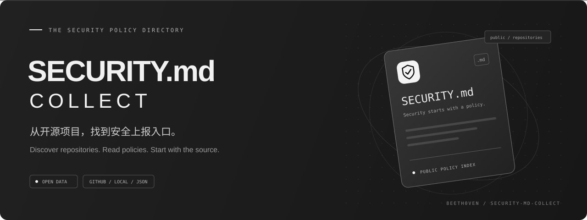

[简体中文](README.md) · [English](README.en.md)

# 开源安全策略索引

按厂商或仓库查找公开 `SECURITY.md`，读上游的安全上报渠道与披露政策。配套 Android 目录收录公开项目、包名和官方来源。

- 浏览或下载仓库政策。[在线策略看板](https://8eeth0ven.github.io/security-md-collect/) · [CSV](索引/总表.csv) · [JSON](索引/dashboard.json)
- 浏览 Android 项目，查看记录对应的范围和核查日期。[Android 目录](赏金APK/README.md)

搜索覆盖全部页，支持多个关键词和常见中英文别名，例如 `阿里 fastjson`。筛选遮住命中时可一键放宽；厂商目录可以直接搜索项目、展开预览，再进入该厂商的完整列表。

[重点项目逐项核查](索引/重点项目核查.json)记录实际检查的仓库、策略原文、账户默认政策、未找到标准文件和重试状态。[厂商应用发现](https://8eeth0ven.github.io/security-md-collect/赏金APK/赏金APK看板.html#app-discovery)将商店发现与已确认 SRC 目标分开；七麦访问限制、替代来源和首屏检索边界均有记录。

要在本机打开已有快照，在仓库根目录用 Python 3.10+ 运行 `python3 脚本/serve.py`，再打开终端显示的地址。浏览已收录的内容无需 GitHub 密钥。

快照可能滞后。是否接受报告、适用范围及赏金条件，以项目当前官方政策为准。覆盖缺口和失败来源可直接查阅。[覆盖审计](docs/coverage.md) · [快照统计](索引/统计.json) · [维护指南](CONTRIBUTING.md)
