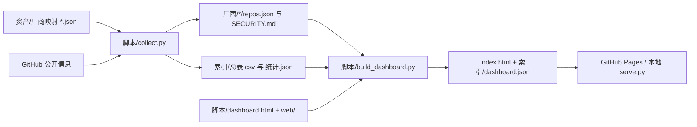

# 代码与发布约定

## 数据流

`collect.py` 完成采集后调用同一生成器。独立执行 `build_dashboard.py` 则从公开的 `厂商/*/repos.json` 和 `索引/统计.json` 重建页面，不需要 `state.json`、token 或联网。

## 为什么这样组织

- **模板、前端资源与快照分离**：首页不再内嵌整份仓库数组；加载一个 JSON 快照，减少 HTML diff，界面迭代不会改动采集逻辑。
- **Pages 子路径兼容**：页面资产和数据使用相对路径。旧的 `索引/index.html` 重定向至根页面，避免维护两套地址。
- **分页而非截断**：匹配和排序覆盖全部记录，DOM 每次仅呈现 25 / 50 / 100 条，末页可达。
- **状态可复现**：关键词、筛选、排序、页码、每页数和英文界面写入 URL。无筛选的首页保留简洁地址；受限存储环境不影响浏览。
- **按实际文件提供本地链接**：仅在 SECURITY.md 文件存在时生成 `loc`；缺失时仍可用 GitHub 上游链接。元数据收录数不等于本地原文份数。
- **跨平台大小写一致**：本地 URL 采用实际目录名的大小写，避免 Windows 构建出的链接在 Linux / GitHub Pages 失效。
- **网络失败不算收录**：`sec_path=error` 表示可重试的网络错误，不是有效策略路径。读取旧状态时将它移回组织待探测队列，不写成负缓存；生成器也会过滤此类记录。`repair_snapshots.py` 可离线修复旧 CSV、厂商 JSON、清单与统计，并把原始记录保留在 `索引/retry-candidates.json`。同步器会在发布前执行这项修复。
- **本地服务仅暴露公开数据**：默认监听 `127.0.0.1:8899`，不提供目录浏览；状态、脚本、token 与 Git 内部文件不对外提供。
- **默认可移植**：目录由脚本位置推导，代理按需配置，HTTPS 使用 Requests 默认的证书校验；不读取用户的全局 Git 凭据。
- **两套完整配色**：`web/dashboard.css` 使用共享语义颜色变量，明亮主题为纯白页面与白色卡片，深色主题为中性灰。默认明亮；右上角可选择明亮、深色或跟随系统。
- **首绘与主题记忆**：`web/theme.js` 在 head 中、CSS 前同步应用已保存的选择，避免先显示错误主题。只有明确选择跟随系统时才响应系统变化；存储不可用时仍可在当前页切换，并同步浏览器原生控件与地址栏配色。主题变化不会重置筛选和语言。

## 数据字段

`索引/dashboard.json` 包含 `stats` 和 `repos`。`stats` 保留统计快照；每条 `repos` 使用以下字段：

| 字段 | 含义 |
| --- | --- |
| `f` / `v` / `src` | `owner/repo`、厂商、披露计划来源描述 |
| `s` / `l` / `lic` | 星数（可为 null）、语言、许可证标识（若可获得） |
| `d` | 仓库描述 |
| `path` | 上游安全策略路径 |
| `loc` | URL 编码后的本地原文路径；文件缺失时为 null |

上游链接使用 `/blob/HEAD/{path}` 以跟随默认分支。原文与元数据可能随上游变化；快照不提供实时有效性保证。时间直接显示采集端写入的快照值，不冒充浏览器本地时间。

## 发布与调度

GitHub Pages 选择 `main` 的根目录。页面源码、`web/`、`索引/dashboard.json` 和需要的公开文件必须一起提交；不需要打包。配置了自定义 `SECMD_BASE` 时，生成器会复制 `web/` 到数据根目录。

仓库不包含自动采集工作流。需要定时更新时，在自己的任务计划或调度器中串行执行采集和提交；不要在日志中输出 token，也不要让多个采集实例共享写入状态。

已有独立采集目录时，`脚本/sync_github.py` 按白名单复制公开快照，不拷贝页面、脚本、配置、凭据和运行状态。发布时先确认工作区干净，再 fast-forward 拉取目标分支，使用目标仓库自己的生成器重建，最后只提交公开数据。原来从采集目录覆盖代码的同步器必须迁移，否则可能撤回后续 UI 改动。文件未变则不重复复制；同步不删除源端已移除的历史文件。

## Android APK 目录

覆盖边界与补采入口见 [覆盖审计](coverage.md)。`update_apk_sources.py` 固定上游 Git 提交后合并四平台，YesWeHack 可直接读取官方分页及详情；保留来源哈希、范围观察时间和未在本轮观察到的历史记录。只解析明确 Android 范围，不把通用描述里的排除应用误收进目录。`expand_policy_sources.py` 补账户默认策略与明确列出的 GitHub 仓库，和定时采集共用独占锁。`audit_coverage.py` 从公开数据与可选本机状态输出分母、未检查清单和国内 SRC 缺口，同步器在每次发布时重建审计。

策略默认按 7 天重新核对，未找到的路径按 30 天重试，`first_seen` 保留、`last_verified` 更新。重新核对发生网络错误时保留上次有效快照；仅确认全部候选路径不存在才移出当前列表。分页中途失败或达到页数上限不标记完成；搜索的 `incomplete_results` 和 1,000 条上限记为未完整，不把搜索命中直接当已保存原文。

`脚本/build_apk_board.py` 读取四份原始平台 JSON，输出 `赏金APK/dashboard.json`、CSV、分类说明和静态页面。页面模板为 `脚本/apk_dashboard.html`，交互为 `web/apk-board.js`；与主页共享明亮 / 深色主题、语言偏好和基础样式。`build_dashboard.py` 在每轮数据发布后调用该生成器，因此旧采集机的 HTML 不会覆盖发布仓库的新版界面。

首屏静态输出前 25 条有赏金记录，完整 JSON 加载后再接管筛选、排序与分页；加载失败时保留首屏清单。Google Play、来源 APK 与第三方镜像候选分别标注，所有候选 `download_verified=false`。无效包名不会生成镜像候选。HackerOne 同时检查计划赏金、目标赏金资格、归档和接收状态，避免把公开 VDP 混作有赏金项目。

独立原始数据目录可用 `python 脚本/build_apk_board.py --base /path/to/data --source /path/to/raw` 更新；该命令只复制公开快照，不访问目标、不下载 APK。`snapshot.json` 的时间是快照整理时间，非上游实时验证时间。

参考：[ProjectDiscovery public-bugbounty-programs](https://github.com/projectdiscovery/public-bugbounty-programs)、[bounty-targets-data](https://github.com/arkadiyt/bounty-targets-data)、[EFF apkeep](https://github.com/EFForg/apkeep)。

## 本轮参考

调研确认这轮使用的是已有常见做法，不宣称原创功能：

- [bounty-targets-data](https://github.com/arkadiyt/bounty-targets-data)：公开数据快照和定时更新说明。
- [public-bugbounty-programs](https://github.com/projectdiscovery/public-bugbounty-programs)：源数据、生成结果与验证分工。
- [disclose/diodb](https://github.com/disclose/diodb)：开放索引和检索入口。
- [next-themes 启动脚本](https://github.com/pacocoursey/next-themes/blob/main/next-themes/src/script.ts)、[MDN prefers-color-scheme](https://developer.mozilla.org/en-US/docs/Web/CSS/Reference/At-rules/@media/prefers-color-scheme)、[MDN localStorage](https://developer.mozilla.org/en-US/docs/Web/API/Window/localStorage)：已有的首绘主题、系统外观与存储容错做法。
