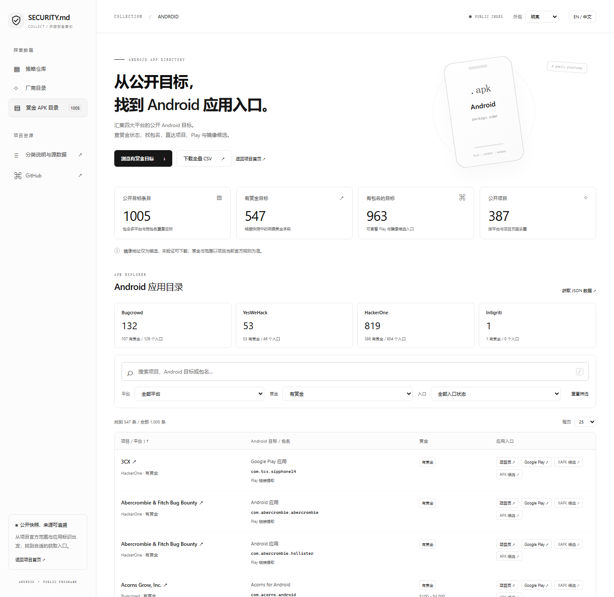

# Android 应用与公开项目目录

按平台、包名和快照中的赏金状态查找项目。每条记录链接到公开来源，可据此核对当前范围。

[在线目录](https://8eeth0ven.github.io/security-md-collect/赏金APK/赏金APK看板.html) · [CSV](dashboard.csv) · [JSON](dashboard.json) · [项目首页](../README.md)

快照日期 `2026-11-16T04:27:05+00:00`。同一包名可以出现在多个项目中，下表按目标记录计数。

| 平台 | 全部记录 | 有赏金记录 | 有应用入口 |
| --- | ---: | ---: | ---: |
| Bugcrowd | 158 | 142 | 121 |
| YesWeHack | 54 | 52 | 44 |
| HackerOne | 831 | 339 | 809 |
| Intigriti | 70 | 48 | 60 |
| 国内 SRC | 54 | 41 | 54 |

官方项目页给出当前范围与奖励条件。项目状态按快照记录，第三方镜像入口待核实。

[历史范围核查](history-review.json) · [来源观察](source-observations.json) · [国内 SRC 证据](src-evidence.json) · [覆盖缺口](../docs/coverage.md)
